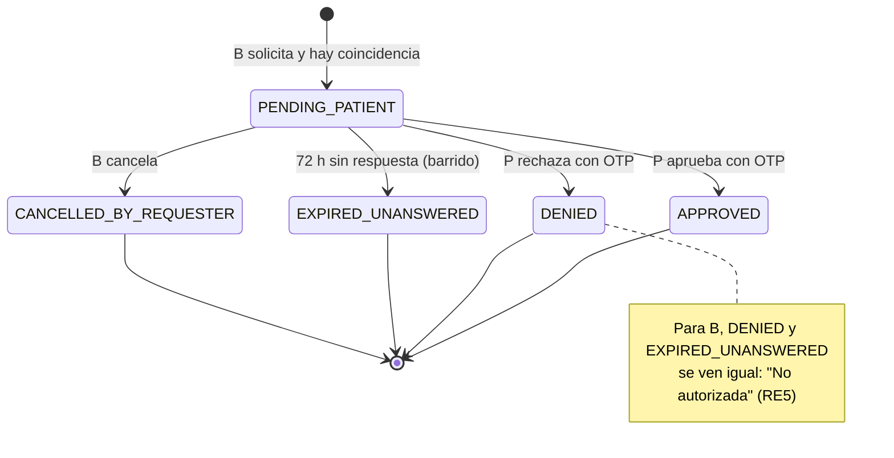
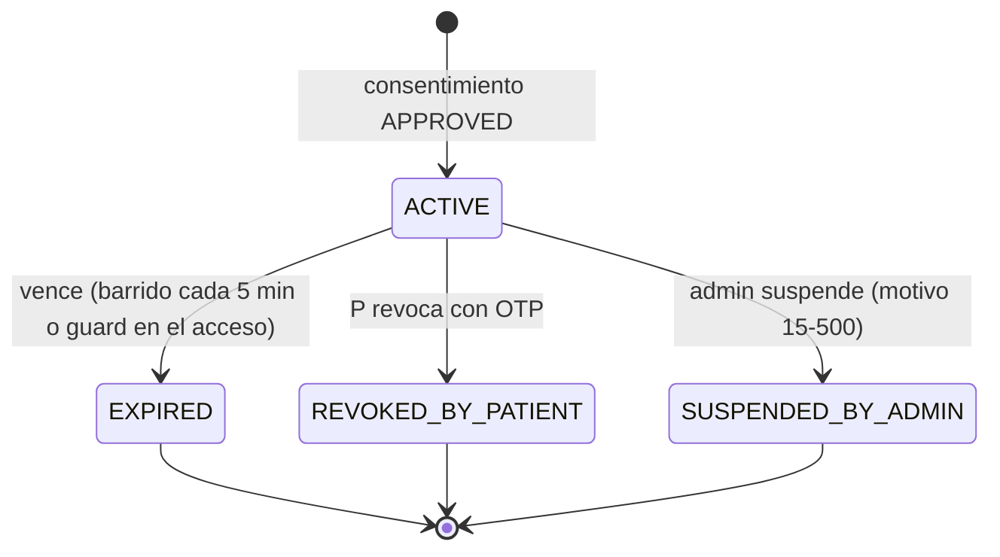

# Expediente compartido autorizado por el paciente (Bloque 1)

> **⛔ Producción bloqueada hasta cerrar la Fase 6 (D-EXP-14).** Además, el adaptador de notificación de desarrollo **impide arrancar** en `NODE_ENV=production` hasta conectar un proveedor real (D-EXP-13).

> **Cambio 2026-11-02 — aviso dentro de la cuenta del paciente.** Por decisión del usuario, la solicitud **solo se crea si el paciente tiene cuenta** en Medicfy (si no, `SHARE_NO_MATCH` con razón `patient_without_account` y la misma respuesta genérica de RE5). Ya no se envía el enlace externo: el paciente ve la solicitud en la **campana de `/mi-cuenta`** (`/mi-cuenta/notificaciones`), la aprueba o rechaza con su **sesión iniciada** —mismas reglas que la página pública (`RecordShareAuthorizationService.applyDecision`), evidencia guardada con `method = PATIENT_SESSION` y `channel` nulo— y revoca sus accesos desde ahí mismo. Rutas: `GET /record-share/me/requests`, `POST /record-share/me/requests/:id/decide`, `GET /record-share/me/grants`, `POST /record-share/me/grants/:id/revoke`. La página pública con código (`/expediente-compartido/autorizar/[token]`) se conserva para cuando exista un proveedor de correo real (D-EXP-13), pero hoy nadie recibe ese enlace. El bloqueo de producción (D-EXP-14 y el adaptador de desarrollo) **no cambia**.

> **Cambio 2026-11-02 (2) — doble autorización y texto nuevo.** El acceso solo se crea cuando el paciente **y** su médico tratante (custodio) aprueban, en cualquier orden (estado nuevo `PENDING_CUSTODIAN`: el paciente ya aprobó y falta el médico; columna `custodianDecision`). El médico decide en "Por autorizar" (campana del menú; `GET /record-share/custodian/requests`, `POST /record-share/custodian/requests/:id/decide`). Si cualquiera rechaza, queda `DENIED` y el solicitante ve "No autorizada" (RE5); mientras falte cualquiera de los dos, el solicitante ve "En espera de autorización". Las dos decisiones se serializan con `SELECT … FOR UPDATE`. Texto de consentimiento nuevo (ver [consentimiento-v0.md](consentimiento-v0.md)), completado en el servidor con el nombre del médico y la fecha; el paciente debe marcar la casilla y se guarda el hash del texto exacto que leyó.

Un médico (B) le pide a un paciente (P) ver su expediente, que lleva otro médico (A, el custodio). Solo P decide si da acceso, qué comparte y por cuánto tiempo. B ve una copia de **solo lectura**, que vence sola y que P puede revocar cuando quiera. Nada sale de Medicfy: B consulta dentro de la plataforma.

Documentos por fase: [00 descubrimiento](00-DESCUBRIMIENTO.md) · [01 modelo](01-modelo-de-datos.md) · [02 solicitud](02-solicitud-del-medico.md) · [03 autorización](03-autorizacion-del-paciente.md) · [consentimiento v0](consentimiento-v0.md) · [04 resumen](04-resumen-clinico-compartible.md) · [FHIR IPS](fhir-ips-mapeo.md) · [05 visor](05-visor-medico-receptor.md) · [06 notificaciones y revocación](06-notificaciones-revocacion-caducidad.md).

---

## 1. Flujo

```mermaid
sequenceDiagram
    autonumber
    actor B as Médico B (solicitante, cédula verificada)
    participant API as Medicfy API
    actor P as Paciente P (sin cuenta)
    actor A as Médico A (custodio)

    B->>API: POST /record-share/requests (nombre, apellidos, nacimiento, tel. o correo)
    API-->>B: 200 genérico, mismo cuerpo y tiempo haya o no coincidencia (RE5)
    Note over API: Búsqueda en segundo plano. Si hay coincidencia, una solicitud por custodio con vínculo activo
    API->>P: Enlace de autorización al contacto REGISTRADO (RE6), sin datos clínicos (RE9)
    P->>API: Abre el enlace, pide OTP, lo valida
    P->>API: Aprueba (alcance ≤ lo pedido, sensibles excluidas por defecto) o rechaza
    API->>P: Confirmación con enlace de revocación
    API->>B: Aviso "aprobada" (o "no autorizada", igual si se rechazó o venció)
    API->>A: Aviso al custodio, sin el nombre del paciente (RE9)
    B->>API: GET /record-share/grants/:id[/sección]; el guard revisa dueño, estado y vigencia EN CADA solicitud
    A->>API: Pestaña "Compartido": quién tiene acceso y cuándo consultó; reportar abuso
    P->>API: Revoca (con OTP propio): bloqueo inmediato
    Note over API: Barrido cada 5 min + guard perezoso: solicitudes y accesos vencidos
```

## 2. Modelo

| Tabla | Qué guarda | Mutabilidad (Postgres, `medicfy_app`) |
|---|---|---|
| `record_share_requests` | La solicitud de B: motivo, alcance y duración pedidos, hash del token del enlace (72 h) | UPDATE de estado; **sin DELETE** |
| `record_share_challenges` | OTP: hash, intentos, reenvíos, bloqueo, `purpose` AUTHORIZE/REVOKE | UPDATE; **sin DELETE** |
| `record_share_consents` | La decisión de P: alcance, sensibles incluidas, embarazo, versión y SHA-256 del texto, IP y user-agent | **Sin UPDATE ni DELETE** (evidencia) |
| `record_share_grants` | El acceso vigente: alcance, categorías excluidas, vigencia, estado, hash del token de revocación | UPDATE de estado; **sin DELETE**; un solo ACTIVE por tripleta solicitante, custodio y paciente (índice parcial) |

### Estados de la solicitud



### Estados del acceso (grant)



Todas las transiciones son compare-and-set (`updateMany` con el estado anterior en el `where`): si dos procesos compiten, solo uno audita y avisa.

## 3. Reglas de la función (RE) y dónde se cumplen

| Regla | Dónde se hace cumplir |
|---|---|
| RE1 Solo el paciente autoriza | Solo las rutas públicas con token + OTP crean consentimiento y grant; ningún endpoint de médico ni de admin lo hace |
| RE2 Solo lo firmado | `SharedSummaryService`: notas, recetas, órdenes y diagnósticos solo de encuentros `SIGNED` (PR-EXP-07 cerró el hueco de recetas y órdenes sobre borrador) |
| RE3 Mínimo necesario | Resumen obligatorio; el resto se agrega de forma explícita; las 5 categorías sensibles van excluidas por defecto |
| RE4 Solo lectura, con vencimiento y revocable | `SharedRecordGuard` en cada GET; el visor no tiene métodos de escritura |
| RE5 Sin enumeración | Respuesta genérica y búsqueda en segundo plano; "rechazada" y "vencida" son indistinguibles |
| RE6 Contacto del custodio | El destino sale de `Patient` (registro del custodio), nunca de lo que captura B |
| RE7 Todo en `audit_log` | 13 eventos de PR-EXP-01 §6 más los de revocación y supervisión |
| RE8 Sin acceso de emergencia | No existe ruta |
| RE9 Nada personal ni clínico en URL, logs ni avisos | Tokens de 256 bits en las rutas; logs sin `error.message` de Prisma; el adaptador de desarrollo escribe en un buzón local, no en el log |

## 4. Decisiones D-EXP

| ID | Decisión aplicada | Estado |
|---|---|---|
| D-EXP-01 | Autoriza el paciente con OTP a su contacto registrado | ✅ |
| D-EXP-02 | El custodio recibe aviso, no aprueba ni revoca; puede reportar abuso | ⚠️ confirmar |
| D-EXP-03 | Solicita un médico con cédula verificada; recibir no exige suscripción | ⚠️ confirmar (precio) |
| D-EXP-04 | Nombre(s), apellidos, nacimiento y (teléfono o correo), comparación exacta normalizada | ✅ |
| D-EXP-05 | Por defecto solo el Resumen | ✅ |
| D-EXP-06 | 7 / 30 / 90 días, 30 por defecto | ✅ |
| D-EXP-07 | Solo en pantalla, con marca de agua; sin PDF ni impresión | ✅ |
| D-EXP-08 | Sensibles excluidas por defecto (lista semilla `pendingMedicalReview`) | ⚠️ revisión médica |
| D-EXP-09 | Embarazo activo incluido por defecto, excluible con advertencia | ⚠️ confirmar |
| D-EXP-10 | Menores bloqueados; la excepción por tutor verificado aún no existe | ✅ (bloqueo total hasta que exista la verificación del tutor) |
| D-EXP-11 | Sin acceso de emergencia | 🔒 LEGAL |
| D-EXP-12 | Texto de consentimiento y nueva finalidad en el aviso de privacidad (borrador técnico versionado) | 🔒 LEGAL |
| D-EXP-13 | Proveedor de envío: interfaz + adaptador de desarrollo | 🔒 PROVEEDOR |
| D-EXP-14 | Producción bloqueada hasta cerrar la Fase 6 | ✅ |

## 5. Batería de seguridad (PR-EXP-07): una prueba por línea

`I` = `record-share-security.integration.spec.ts` (Postgres real) · `U` = `record-share-security.spec.ts` (sin base) · `W` = `expediente-compartido-urls.spec.ts` (web).

| Línea | Prueba |
|---|---|
| Sin enumeración (respuesta y tiempo) | I·B01 |
| OTP solo al contacto del custodio | I·B02 |
| Fuerza bruta de OTP → bloqueo | I·B03 |
| Reutilización de OTP | I·B04 |
| Reutilización o vencimiento del enlace | I·B05 |
| Ampliación de alcance por la API | I·B06 |
| IDOR en todos los GET del visor | I·B07 |
| Grant vencido o revocado → 403 | I·B08 |
| Médico no verificado | I·B09 |
| Menor sin tutor | I·B10 |
| Borradores nunca visibles | I·B11 + U (consultas filtran `SIGNED`) |
| Sensibles sin rastro en todas las secciones | I·B12 + U |
| DELETE en tablas nuevas / UPDATE en consentimiento | I·B13 (+ `record-share-model.integration.spec.ts`) |
| Nada personal en URL ni query string | I·B14 + U (rutas, `@Query`, plantillas de enlace) + W (rutas web, llamadas a la API) |
| Ningún OTP ni dato clínico en logs | I·B15 (flujo completo capturado) + U (adaptador, errores de Prisma, inspección de código) |
| Producción no arranca con el adaptador de desarrollo | I·B16 + U |
| Cada evento de PR-EXP-01 §6 en `audit_log` | I·B17 + U (guarda que falla si un evento deja de verificarse) |

E2E (Playwright, tableta 1280×800, pila completa): `medicfy-frontend/apps/web/e2e/expediente-compartido.spec.ts`, los 7 pasos del prompt. El enlace y el OTP del paciente se leen del buzón de desarrollo (`$TMPDIR/medicfy-dev-outbox.log`, configurable con `E2E_DEV_OUTBOX_PATH`).

## 6. Pendientes

### 🔒 Bloqueados por decisión externa (para Jorge)
- **Proveedor de envío** (correo/SMS/WhatsApp para el paciente), D-EXP-13.
- **Texto legal del consentimiento** (hoy `draft`, versionado y con hash), D-EXP-12.
- **Aviso de privacidad**: la nueva finalidad, D-EXP-12.
- **Revisión médica de la lista de sensibles** (rangos CIE-10 y ATC semilla), D-EXP-08.
- **Clase ATC según la base licenciada**: `PatientMedication` no tiene FK al catálogo, así que el filtro ATC de medicamentos sensibles no se aplica todavía.
- **Acceso de emergencia**, D-EXP-11.
- **Precio para receptores**, D-EXP-03.

### ⚠️ Implementado con un valor por defecto, por confirmar
- D-EXP-02, D-EXP-09 (ver tabla).
- RE6 adaptado: no existe "contacto registrado por el custodio" separado; se usa el contacto único del `Patient` global.
- Canal por defecto: correo.
- El límite diario (20) se cuenta sobre `audit_log SHARE_REQUESTED`, porque las solicitudes sin coincidencia no crean fila.
- No hay especialidades psiquiátricas en el catálogo, así que el filtro "por especialidad" es hoy un no-op.
- Sin marca de estudio genético; los antecedentes (`historyItems`) no se filtran por categoría.
- El enlace de revocación muestra **todos** los accesos vigentes del paciente.
- La suspensión del admin usa el mismo aviso neutro de "revocado" para el solicitante.
- No se avisa al paciente cuando su acceso vence ni cuando el admin lo suspende.
- Las capturas de pantalla no se pueden impedir (solo marca de agua).
- `ConsoleEmailChannelAdapter` (M12, fuera de este track) escribe en el log el correo y el cuerpo de los avisos a **médicos**: sin datos clínicos, pero sí con un dato personal.

### Siguiente fase natural
Envío del Resumen al sistema hospitalario vía **FHIR IPS** (fase 2 con hospitales); el mapeo ya está declarado en [fhir-ips-mapeo.md](fhir-ips-mapeo.md).
